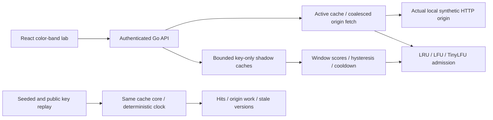

# Tidal

Tidal tests cache policies against observed traffic while accounting for origin work and stale responses.

## Result

Scan-heavy synthetic replay: **24.29% → 27.11% hit rate**, 22,713 → 22,641 origin calls over 30,000 requests, including 774 adaptive early refreshes.  
Complete public Web12 key order: adaptive **48.12% vs LRU 48.53% hits**, 50,329 vs 49,209 origin calls over 95,607 requests — adaptation hurts here.  
Web12 with synthetic freshness annotations: **404 adaptive vs 499 LRU stale serves**; timing, writes, TTL and invalidations are modeled, not original public metadata. [Full comparison and raw evidence](docs/results/COMPARISON.md).

## Architecture



## Run it

Go, Node/npm and Python with venv are prerequisites. Pinned package/toolchain downloads happen during setup; the licensed public trace is included.

```sh
make demo
# Open http://127.0.0.1:8095; replay traffic or query the live cache. Ctrl-C stops it.
make lint test bench
```

[Exact demo/recording steps](docs/DEMO.md), [quality report](docs/QUALITY.md), [design](docs/DESIGN.md), [interview kit](INTERVIEW.md), [follow-up drill](DRILL.md).

## Decisions and limits

- Original Go policy/refresh/invalidation core; TinyLFU-style sketch admission over an LRU victim, not W-TinyLFU. A global generation fences in-flight invalidation; a real failure test retains the old-response rejection. [Race/reference/HTTP output](docs/results/tests.log), [ADRs](docs/adr/).
- The three synthetic traces and complete public trace use equal resident object capacities. Shadow/sketch metadata is extra memory. Public Web12 supplies key order only, with [upstream attribution and hash](docs/results/trace-provenance.json). Object sizes, request clock and content versions are synthetic. This is not a public production freshness result.
- Early refreshes count as origin work. Adaptation loses on several traces, including stable/shifted hot sets and Web12 origin load; the table retains those results. More hits do not guarantee fresher responses or lower total cost.
- Replay executes refresh inline against a modeled origin; Live cache uses bounded asynchronous refresh and an actual loopback HTTP origin. Replay is not service throughput. HTTP load capacity, tail latency under load and production dollar savings are **not measured**.
- The API caches typed synthetic JSON objects, not arbitrary HTTP responses. Unannounced origin changes can stay stale within the TTL contract; no invalidation oracle or stale-on-error fallback is promised. [Caught initial null-list UI failure](docs/results/caught-initial-null-windows.json) and corrected HTTP regression test are retained.
- Local bearer-authenticated demo, disposable cache/origin state; remote TLS terminates at an external proxy. Docker/Render are prepared only: **not deployed**. Cinder integration is [proposed separately](docs/CINDER_INTEGRATION_PROPOSAL.md); existing projects remain unchanged. No company adoption is claimed.

## Next

Isolated tuning studies for TTL versus eviction versus refresh; byte/cost-aware admission; faster LFU/expiry structures; replay with original timestamp/size/update metadata when legally available; cooperative replay cancellation, stronger operational quotas, production origin contracts and a separately tested Cinder adapter. [Migration record](docs/migration/tidal.md).
